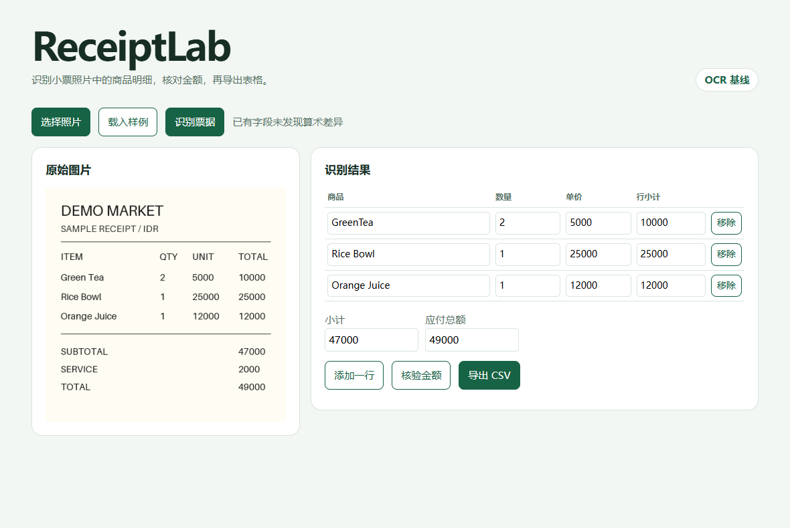

# ReceiptLab

ReceiptLab 把一张小票照片转换成商品明细和应付总额。浏览器页面并排展示原图和可编辑表格，支持金额核验和 CSV 导出。

项目比较三种方案的表现。RapidOCR 加行分组规则作为 CPU 基线，Qwen3-VL-4B-Instruct 作为视觉模型基线，在同一模型上训练 NF4 QLoRA 适配器。评测同时记录清晰原图和固定图像扰动后的结果。

## 实测结果

在 CORD v2 官方测试集的 100 张原图上，原版和微调版的商品行精确匹配 F1 分别为 **4.8%** 和 **54.8%**。应付总额准确率从 **75.8%** 到 **84.2%**。训练用了 240 张小票和 60 次优化器更新。

[评测报告](reports/benchmark.md) 包含 OCR 基线、图像扰动、各字段分数和错误分析。



## 运行演示

环境需要 Python 3.12。CPU 演示只需要 Pillow 和 RapidOCR。启动后打开 `http://127.0.0.1:7860`，可以载入内置虚构样例，修改识别结果后重新核验或导出。

```bash
python -m pip install pillow==12.0.0 rapidocr-onnxruntime==1.4.4
python -m receiptlab.demo --engine ocr
```

GPU 实验使用单卡 CUDA 环境。先安装与驱动兼容的 PyTorch 和 torchvision，再装其余依赖。下面是实验中使用的 PyTorch CUDA 12.8 组合。

```bash
python -m pip install torch==2.7.1 torchvision==0.22.1 --index-url https://download.pytorch.org/whl/cu128
python -m pip install -r requirements-ml.txt
python -m receiptlab.demo --model Qwen/Qwen3-VL-4B-Instruct --adapter runs/adapter
```

可从 [v0.1.0 Release](https://github.com/xvyean/receiptlab/releases/tag/v0.1.0) 下载适配器，解压到 `runs/adapter`。省略 `--adapter` 可用原版模型。服务器上默认只监听回环地址，可以通过 SSH 本地转发访问。

如果 Linux 的 OpenCV 缺少图形库，把无图形版本放到独立目录，再通过 PYTHONPATH 加载。Triton 首次编译需要 GCC 和与 Python 版本匹配的开发头文件。

~~~bash
python -m pip install --target .ocr-headless --no-deps opencv-python-headless==4.11.0.86
PYTHONPATH=.ocr-headless python -m receiptlab.demo --engine ocr
~~~

## 复现实验

默认从 Hugging Face 加载固定版本的 [CORD v2](https://huggingface.co/datasets/naver-clova-ix/cord-v2) 和 [Qwen3-VL-4B-Instruct](https://huggingface.co/Qwen/Qwen3-VL-4B-Instruct)。离线时可用 `--data` 指向 6 个 Parquet 分片所在的目录，用 `--model` 指向完整的模型快照目录。

```bash
python -m unittest discover -s tests -v
python -m receiptlab evaluate --engine ocr --split test --output runs/test-ocr
python -m receiptlab evaluate --split validation --limit 20 --batch-size 4 --output runs/validation20
python -m receiptlab train --steps 60 --accum 4 --seed 42 --output runs/adapter
python -m receiptlab evaluate --split test --batch-size 4 --output runs/test-base
python -m receiptlab evaluate --split test --batch-size 4 --adapter runs/adapter --output runs/test-tuned
```

`evaluate` 每次生成聚合结果 `summary.json` 和逐样本的 `predictions.jsonl`。运行 `--limit 20 --variants blur tilt` 可以重复鲁棒性实验。`blur` 是半径为 2 的高斯模糊，`tilt` 是 9° 旋转。变换后的图片沿用原票据标签，结果分开统计。

- 训练只用官方 train 划分。训练目标是规范化后的 JSON，只对回答 token 计算损失。NF4 量化冻结基础权重，LoRA 只训练语言模型注意力投影。
- 行级 F1 用多重集合匹配规范化后的「商品名、数量、单价、行小计」，因此重复商品也会计入。总额准确率只统计有总额标注的样本。无法解析的模型输出计作无预测。
- 金额核验分别比较数量 × 单价和行小计、商品行合计和小票小计。税费、折扣和舍入可能造成合法差异，页面保留识别值供人工复核。
- 延迟为热启动后的批处理耗时除以批内样本数，包含预处理和生成。CPU 和 GPU 的批大小不同，报告按各自的批大小解释。

## 数据和许可

CORD v2 由 NAVER CLOVA 发布，数据卡标为 CC BY 4.0，样本主要是印尼商店和餐厅小票。仓库包含代码、合成演示样例生成器和汇总评测结果。数据分片、逐张预测和模型权重通过脚本或命令在本地准备。

项目代码使用 MIT 许可证。模型权重及数据沿用各自上游许可。
